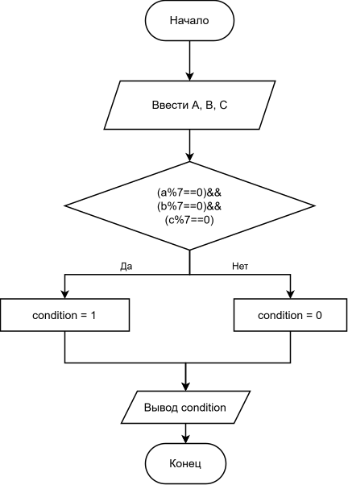

# Домашнее задание к работе 4

## Условие задачи (Вариант 10 — Фабрика игрушек)

Контроль качества на фабрике игрушек пропускает партию, если вес каждой из трех случайно выбранных игрушек (A, B, C грамм) кратен семи. Это свидетельствует о соблюдении технологических норм. Запишите условие принятия партии.

---

## 1. Алгоритм и блок-схема

### Алгоритм

1. Вывести сообщение о назначении программы и запросить у пользователя вес трех игрушек в граммах: `a`, `b`, `c`.
2. Вычислить логическое условие принятия партии без использования условного оператора `if`:  
   `condition = (a % 7 == 0) && (b % 7 == 0) && (c % 7 == 0)`.
3. Вывести результат вычисления логического выражения (`1` — да, партия принята; `0` — нет, партия не принята).
4. Завершить программу.

### Блок-схема



---

## 2. Реализация программы

Исходный код программы: [4lab.c](4lab/4lab.c)

## 3. Результаты работы программы

Пример работы программы при выполнении условия (все числа кратны 7):

```
=== КОНТРОЛЬ КАЧЕСТВА ФАБРИКИ ИГРУШЕК ===
Введите вес трех игрушек в граммах (A, B, C):
700
700
700
Партия принята (1 - да, 0 - нет): 1
```

Пример работы программы при невыполнении условия:

```
=== КОНТРОЛЬ КАЧЕСТВА ФАБРИКИ ИГРУШЕК ===
Введите вес трех игрушек в граммах (A, B, C):
300
250
200
Партия принята (1 - да, 0 - нет): 0
```

---

## 4. Информация о разработчике

- **ФИО:** Хлебников Иван Алексеевич
- **Группа:** бОТИ-261
